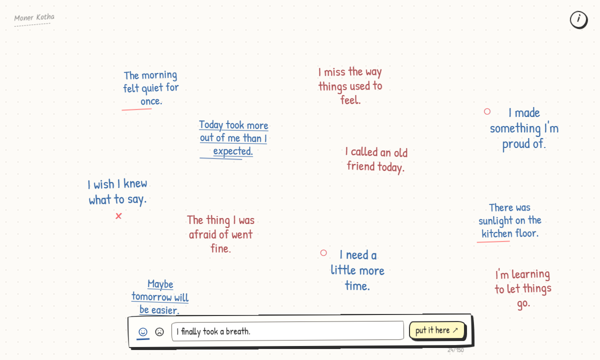
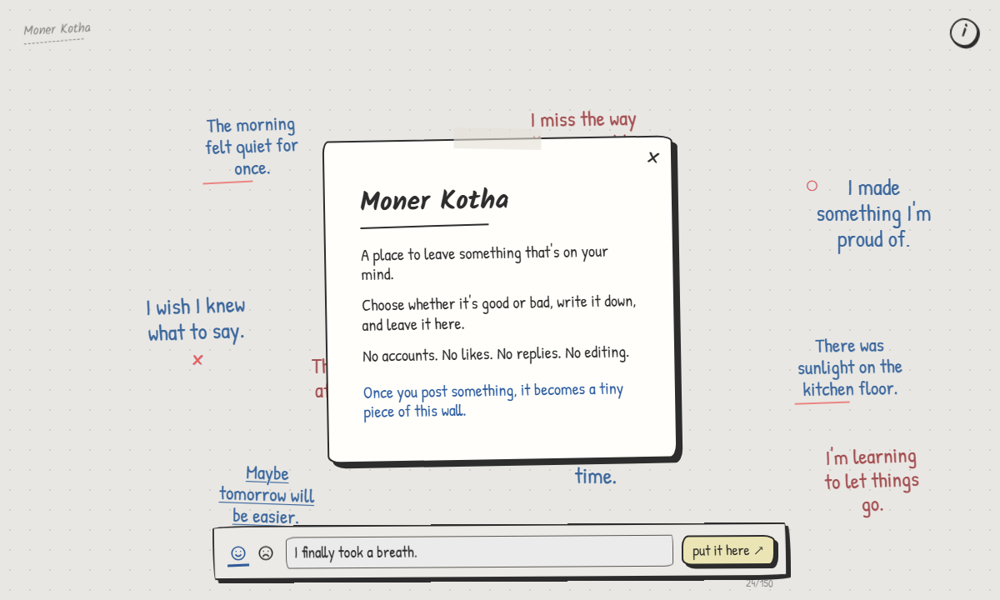

# Moner Kotha Canvas

Anonymous thoughts on an infinite canvas, built as a pnpm workspace.

## Featured screenshots

### The thought canvas

Drag to explore handwritten thoughts, or choose a mood and add one of your own.

### About the canvas

The taped paper panel explains how to leave a thought anonymously.

## Stack

- Frontend: Vite, React, React Router, React Query, Tailwind CSS
- Backend: Hono on Cloudflare Workers
- Database: Neon Postgres with Drizzle ORM

Authentication and Docker are intentionally not included.

## Development

1. Copy `apps/backend/.dev.vars.example` to `apps/backend/.dev.vars` and set your Neon `DATABASE_URL`.
2. Copy `apps/frontend/.env.example` to `apps/frontend/.env` if the API is not at `http://localhost:8787`.
3. Install dependencies with `pnpm install`.
4. Start both applications with `pnpm dev`.

Use `pnpm db:generate` and `pnpm db:migrate` after changing the database schema. For Cloudflare deployment, add `DATABASE_URL` with `wrangler secret put DATABASE_URL` from `apps/backend`.

---
